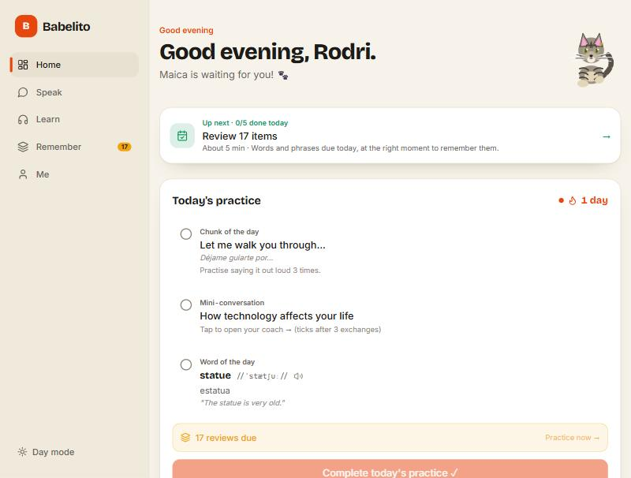
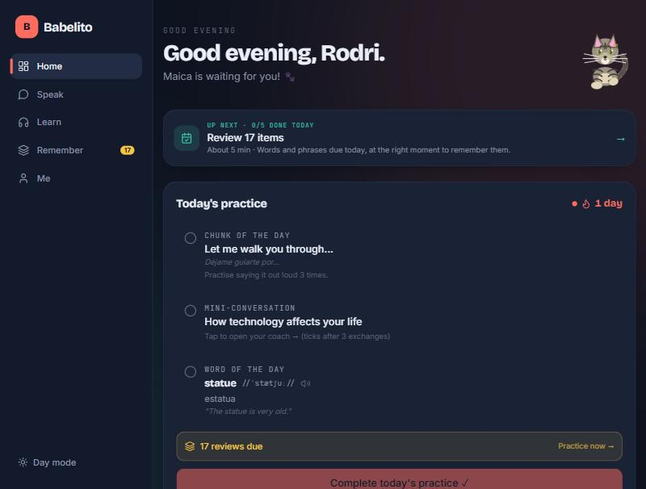
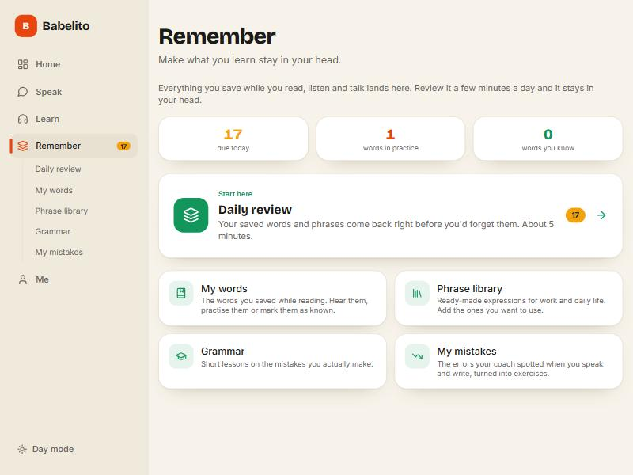
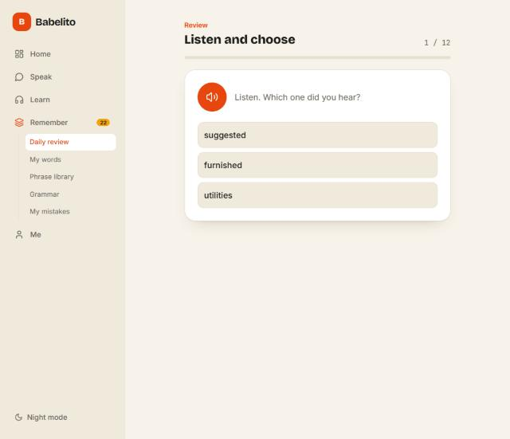
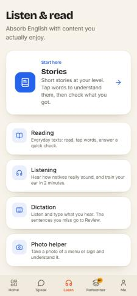
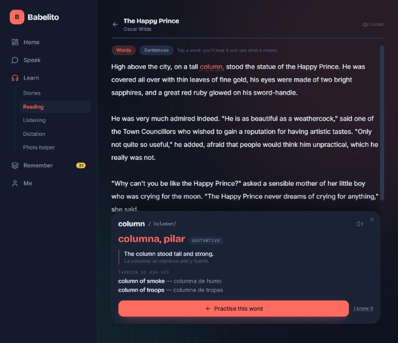
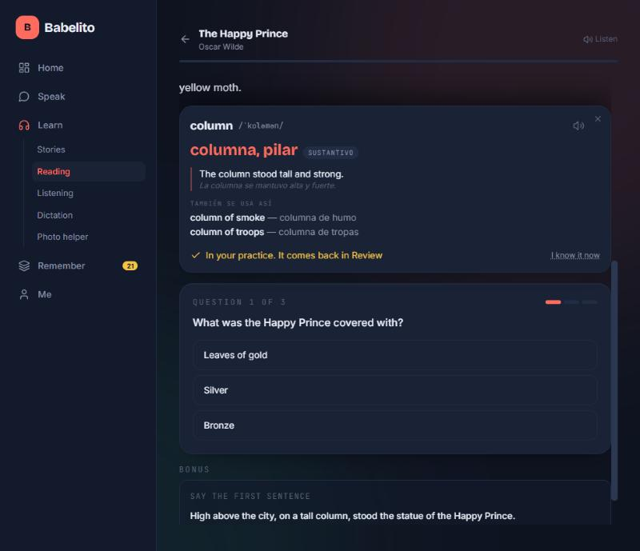

# 11. Guía de diseño

Los colores, tipografías y componentes de la app. Todo vive en tres archivos: `src/index.css` (variables y componentes), `tailwind.config.js` (nombres de colores) y `src/lib/theme.ts` (colores para SVG y cambio de tema).

## Dos temas

La app tiene **Día** (por defecto) y **Noche** (el diseño original). Se cambia con el botón del menú lateral o de Perfil. La elección se guarda en el dispositivo (`localStorage: babelito:theme`) y se aplica antes de pintar con `public/theme-init.js` (por eso no hay parpadeo; la CSP no permite scripts en línea). El atributo `data-theme="night"` en `<html>` activa Noche.

### Paleta (variables CSS, en RGB)

| Token | Día | Noche | Uso |
|---|---|---|---|
| `ink-900` | `247 243 234` crema | `14 19 32` azul noche | Fondo de la página |
| `ink-800` | `240 234 221` | `19 26 43` | Menú lateral, campos |
| `ink-700` | `255 255 255` blanco | `26 34 54` | Tarjetas |
| `ink-600` | `232 225 210` | `34 44 68` | Bordes suaves, chips |
| `ink-500` | `212 203 184` | `44 56 82` | Bordes fuertes, hover |
| `paper` | `28 27 24` tinta | `234 238 247` | Texto principal |
| `paper-muted` | `104 99 88` | `138 147 168` | Texto secundario |
| `paper-faint` | `140 134 120` | `90 99 121` | Texto terciario |
| `coral` | `232 70 15` tangerina | `255 107 94` coral | Acción principal, marca |
| `mint` | `18 150 92` verde | `54 197 168` | Acierto, éxito |
| `gold` | `242 162 12` ámbar | `246 196 69` | Racha, avisos |
| `sky` | `37 99 235` azul | `96 165 250` | Puerta "Learn" |
| `ongold` | `28 27 24` fijo | igual | Texto sobre dorado (siempre oscuro) |

Cada color tiene variantes `-soft` y `-deep` (`coral`, `mint`, `gold-soft`, `sky-soft`). Se usan con las clases de Tailwind de siempre (`bg-coral`, `text-paper-muted`, `bg-mint/15`…), porque los colores se definen como `rgb(var(--token) / <alpha-value>)`.

### Color por puerta

| Puerta | Color |
|---|---|
| Speak | `coral` (naranja) |
| Learn | `sky` (azul) |
| Remember | `mint` (verde) |
| Me | `gold` (dorado) |

## Tipografías (instaladas en la propia app, sin pedirlas a Google)

| Uso | Familia |
|---|---|
| Títulos y números grandes | **Bricolage Grotesque** (700–800) |
| Texto | **Inter** (400–700) |
| Código y fonética | **JetBrains Mono** |

Reglas globales: títulos con `text-wrap: balance`, párrafos con `text-wrap: pretty`, números con `tabular-nums`, suavizado de fuente activado.

## Componentes base (`src/index.css`)

| Clase | Qué es |
|---|---|
| `.card` | Tarjeta blanca con borde suave y sombra en capas |
| `.card-interactive` | Tarjeta clicable; en Día, al pasar el mouse sube un poco y toma borde y sombra de tinta |
| `.btn-coral` / `.btn-mint` | Botón principal / de acierto. En Día es "tipo tecla": tiene una sombra inferior que se aplasta al presionar |
| `.btn-ghost` | Botón secundario |
| `.input` | Campo de texto |
| `.eyebrow` | Etiqueta pequeña sobre el título; en Día es texto normal en naranja, no mayúsculas mono |
| `.page-title` | Título de página (3xl–4xl, extrabold) |
| `.stagger` | Hace entrar los hijos uno tras otro (hasta 10) |
| `.skeleton` | Bloque de carga con brillo |
| `.empty-state` | Estado vacío con título y ayuda |

## Movimiento

- Entradas suaves (`animate-fade-up`, `card-in`) y un rebote corto para logros (`check-pop`, `level-up-pop`).
- Botones: se hunden al presionar (`scale 0.97` y, en Día, `translateY 2px`).
- Transiciones con propiedades concretas (nunca `transition: all`).
- Se respeta `prefers-reduced-motion`: las animaciones se reducen al mínimo.

## Reglas para mantener la coherencia

1. **Nunca escribir colores sueltos** (`#E8460F`) en componentes. Usar las clases de Tailwind o `BRAND` de `theme.ts` para SVG.
2. Los acentos (`coral`, `mint`, `gold`) sirven en ambos temas; el texto sobre dorado debe ser `text-ongold`.
3. Sombras con `var(--card-shadow)` o `var(--pop-shadow)`, no valores fijos oscuros (se ven mal en Día).
4. Probar cada pantalla nueva **en los dos temas** y en celular (375 px).
5. La interfaz está en el idioma que se aprende; el español queda como ayuda neutra.
6. Cada pantalla explica para qué sirve y termina con un siguiente paso.

## El gato Maica

La mascota es un gato atigrado gris dibujado en SVG (`src/components/Maica.tsx`) con varios estados (feliz, dormido, curioso, celebrando…) y animaciones propias definidas en `index.css`.

## Capturas

Capturadas al cierre (7 de noviembre de 2026).

**Inicio · modo Día**

**Inicio · modo Noche**

**Remember · modo Día** (verde, con números reales)

**Repaso diario · modo Día**

**Learn en celular · modo Día**

**Lectura: tarjeta de palabra** (captura en modo Noche, antes del cambio de tema)

**Lectura: cierre con comprensión** (captura en modo Noche)

